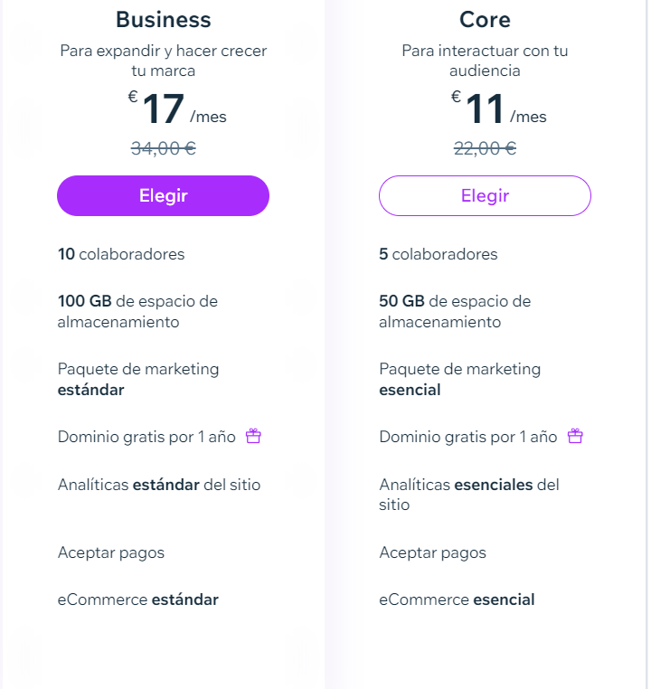

# E-commerce

# ¿Qué es un e-commerce?

El e-commerce es la práctica de comprar y vender productos a través de internet. 

cualquier tienda.. inditex, Pc Componentes

# Marketplace

Un e-commerce, que vende productos de distintos proveedores o marcas.

Wallapop, Amazon (shop), shein,

## Partes de un e-commerce

### Web composition

- **PDP**: Product description page
- **PLP**: Product list page
- **Pasarela de compra**. Incluye el pago, dirección, registro del usuario…
- **The cart** / cesta
- **User engagement**: wishlist → to engage the user and to get info from them

### Logistics

- Almacén
- Envíos

# ¿Cómo se hace un e-commerce?

Existan ‘plantillas’ para levantar un e-commerce desde 0 sin tener que programar todo, evitamos reinventar la rueda.

- **WIX** << tested
- **Hostinger** (es de pago)
- **Shopify** ( muy de pago)
- **IONOS**
- **Webador** <<
- **Prestashop**

|  | Wix | Webador |
| --- | --- | --- |
| Facilidad de la UI | ++ | — |
| UX (User Experience) | ++ | — |
| Integración métodos de pago | Podemos vincular Paypal pero no se puede pagar en la practica sin hacer upgrade. |  |
| Manejo del catálogo |  | poca posibilidad de configuración |
| Marketing | Integración con google ads | pobre y de pago |
| URL del ejemplo creado | https://moligarh8.wixsite.com/vendeshop | [gratis-5526956.webadorsite.com](http://gratis-5526956.webadorsite.com/) |
| Analíticas | bastante potente. En tiempo real. Muchos parámetros incluso por ubicación. Cifras por *breadcrumbs* | Hay que pagar para ver estadísticas completas. |
| Precio |  | Te pide por funcionalidades como las analíticas.
 |
| Feed de actividad | ++ |  |
| Tarifa de envio | Personalizable |  |
- Con el dominio gratuito podemos hacer esto funcionar de verdad. Comprar articulos.

# SEO

SEO significa Search Engine Optimization (optimización para los motores de búsqueda) El objetivo es que después de una búsqueda, aparecer lo mas alto posible en la lista del buscador.

- Hacer uso de keywords
- Velocidad de carga rápida de los contenidos
- Diseño responsive.  La web es adaptable y 100% funcional en dispositivos móvil
- Breadcrumbs

Request For Comments >> Architecture Decision Record

KPIs vs OKRs

# OKRs

1. Entrega  en menos de 5 días

1. Tener mas de 20 visitas al mes

## SSO - Single Sign On

Es dar a cliente la posibilidad de registrarse en tu pagina web directamente utilizando el inicio de sesión de otra plataforma (Google, Microsoft, Apple, LinkedIn)

## Hosting:

 Un **hosting** es el almacenamiento que aloja la información de diversos sitios web y que, por tanto, resguarda el contenido de un **dominio**.

# KPIs

1. 95% de los pedidos se entregan en menos de 5 días
2. Trabajar solo con compañías logística de que garantizan una entrega en menos de 4 días.

1. 10 visitas por acceso móvil
2. Otras 10 ordenador
3. primeros 15 días haber tenido 10 visitas

# Coste inicial del Go-Live Plan

Dominio Wix (.com) - 19,35€/año

IONOS- Dominio→1€ primer año (12€ depués)

E-mail+Dominio(primer año)→ 1€ primer año (2,50€ después)1

Plan premium de Wix→

Core: 11€/mes(primer mes) 22€     ——>(253€/año)